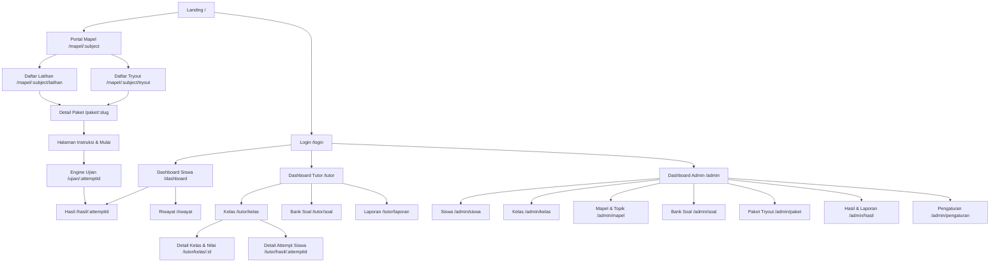
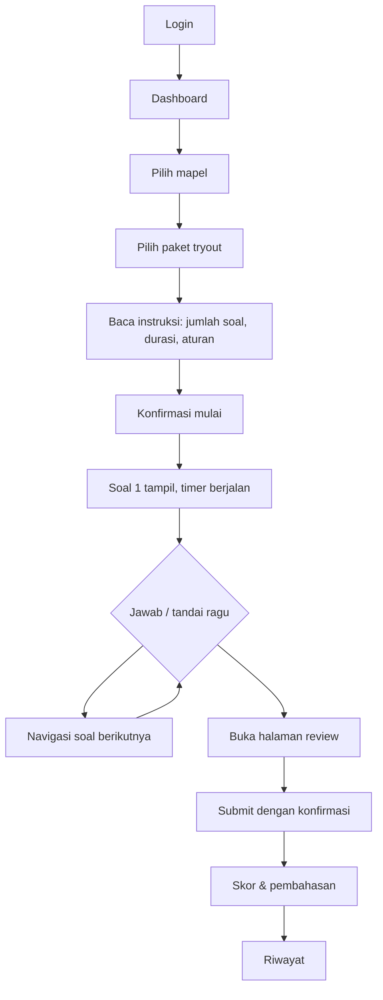
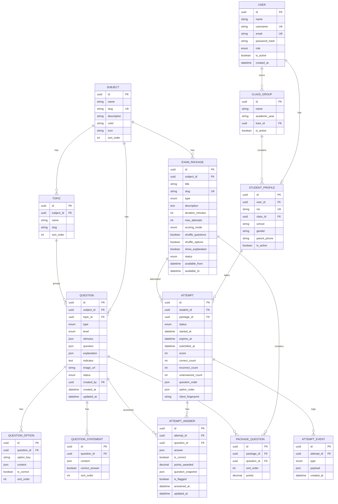
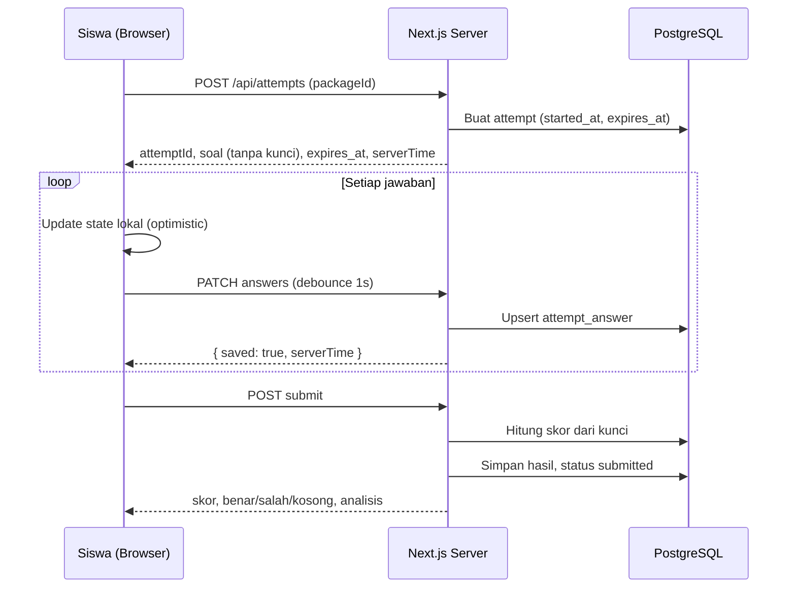

# PRD (RPD) — Aplikasi Simulasi TKA Kelas 6 SD

**Nama produk (sementara):** BIMBEL STAR KIDS  
**Untuk:** Bimbel [Nama Bimbel]  
**Versi dokumen:** 0.1 (Draft)  
**Tanggal:** 16 November 2026  
**Status:** Menunggu review pemilik produk  
**Referensi produk:** <https://sd.onedumind.com/>

> Catatan: Dokumen ini adalah PRD (*Product Requirements Document*), yaitu dokumen yang dalam diskusi kita disebut "RPD". Fokus dokumen ini adalah **apa yang dibangun, untuk siapa, dan kriteria selesainya** — belum membahas kode secara rinci.

---

## 1. Ringkasan Eksekutif

BIMBEL STAR KIDS adalah aplikasi web untuk siswa kelas 6 SD/MI yang mengikuti bimbingan belajar, digunakan untuk:

1. **Latihan soal** per mata pelajaran dan topik.
2. **Tryout simulasi TKA** dengan durasi, navigasi soal, dan penilaian otomatis.
3. **Melihat hasil, pembahasan, dan analisis kemampuan** per topik dan level kognitif.
4. **Membantu tutor/admin bimbel** memantau perkembangan siswa, mengelola bank soal, dan membuat laporan.

Berbeda dari referensi yang masih statis (satu halaman HTML per paket, jawaban hilang saat refresh, tanpa akun siswa), BIMBEL STAR KIDS dirancang sebagai aplikasi **multi-user** dengan **database siswa bimbel**, **autosave**, **timer server-side**, dan **dashboard tutor**.

Stack utama: **Next.js (App Router) + TypeScript + Tailwind CSS + Prisma + PostgreSQL**, dengan HTML/CSS/JS sebagai fondasi antarmuka. Aplikasi bersifat **mobile-first** karena mayoritas siswa akan mengakses lewat HP.

---

## 2. Latar Belakang & Masalah

### 2.1 Konteks

TKA (Tes Kompetensi Akademik) menjadi salah satu tolok ukur kesiapan siswa kelas 6. Bimbel membutuhkan alat simulasi yang:

- Mirip ujian sebenarnya (timer, jumlah soal, tipe soal).
- Mudah dipakai siswa SD.
- Memberi umpan balik cepat berupa skor dan pembahasan.
- Memberi data ke tutor: siapa yang sudah siap, topik apa yang lemah.

### 2.2 Masalah pada solusi saat ini (referensi)

| Masalah | Dampak |
|---|---|
| Semua soal dalam satu halaman panjang | Siswa sulit melompat, mudah kehilangan posisi, tidak seperti ujian |
| Tidak ada akun & riwayat | Tutor tidak bisa memantau perkembangan siswa |
| Refresh/keluar = jawaban hilang | Siswa frustrasi dan hasil tidak valid |
| Timer hanya di sisi klien | Bisa dimanipulasi, tidak adil untuk tryout serentak |
| Koreksi baru muncul setelah semua soal terjawab | Tidak ada mode latihan bertahap |
| Skor hanya total | Tutor tidak tahu topik/level kognitif mana yang lemah |
| Tidak ada pembatasan akses | Semua orang bisa mengakses paket yang sama |
| Iklan di halaman ujian | Mengganggu konsentrasi anak |

### 2.3 Peluang

Membuat aplikasi yang **terintegrasi dengan data bimbel**, sehingga tryout bukan sekadar kuis, tetapi bagian dari proses belajar yang terukur.

---

## 3. Tujuan & Metrik Keberhasilan

### 3.1 Tujuan produk

| ID | Tujuan |
|---|---|
| G1 | Siswa dapat mengerjakan latihan dan tryout TKA secara mandiri dengan nyaman di HP. |
| G2 | Jawaban siswa tersimpan otomatis dan tidak hilang saat koneksi terputus atau halaman di-refresh. |
| G3 | Siswa langsung mendapat skor dan pembahasan setelah submit. |
| G4 | Tutor dapat melihat rekap nilai dan kelemahan siswa per topik. |
| G5 | Admin dapat mengelola data siswa, kelas, bank soal, dan paket tryout tanpa menyentuh kode. |

### 3.2 Non-goals (tidak termasuk MVP)

- Aplikasi native Android/iOS.
- Video pembelajaran dan kelas live.
- Pembayaran online.
- Kecerdasan buatan untuk membuat soal otomatis.
- Analisis butir soal tingkat lanjut (IRT/parametrik).
- Multi-bimbel (SaaS multi-tenant) — disiapkan di arsitektur, tetapi belum diaktifkan.
- Modul materi lengkap (fase 2).
- Leaderboard publik (fase 2, dengan pertimbangan privasi anak).

### 3.3 Metrik keberhasilan (KPI)

| Metrik | Target awal |
|---|---|
| Tingkat penyelesaian tryout (submitted / dimulai) | ≥ 85% |
| Autosave berhasil | ≥ 99% |
| Waktu muat halaman ujian (4G) | ≤ 3 detik |
| Waktu koreksi otomatis setelah submit | ≤ 2 detik |
| Siswa dapat menemukan hasil & pembahasan | ≤ 2 klik dari dashboard |
| Tutor dapat melihat rekap kelas | ≤ 3 klik |
| Error rate halaman ujian | < 1% sesi |
| Kepuasan siswa (survei singkat) | ≥ 4/5 |

---

## 4. Pengguna & Peran

### 4.1 Persona

| Persona | Deskripsi | Kebutuhan utama |
|---|---|---|
| **Siswa** (11–12 tahun) | Peserta bimbel kelas 6, terbiasa HP, literasi digital terbatas | Tampilan sederhana, tombol besar, jelas mana yang sudah dijawab, tidak takut kehilangan jawaban |
| **Tutor/Guru** | Pengajar bimbel yang memegang 1–3 kelas | Lihat progres kelas, nilai, soal yang sering salah, beri tindak lanjut |
| **Admin** | Pengelola bimbel | Kelola akun siswa, kelas, mapel, bank soal, paket tryout, ekspor laporan |
| **Orang tua** (fase 2) | Memantau hasil anak | Ringkasan hasil dan rekomendasi belajar |

### 4.2 Matriks hak akses

| Fitur | Siswa | Tutor | Admin |
|---|---|---|---|
| Login | ✅ | ✅ | ✅ |
| Melihat daftar mapel & paket yang tersedia | ✅ | ✅ | ✅ |
| Mengerjakan latihan/tryout | ✅ | — | — |
| Melihat hasil & pembahasan milik sendiri | ✅ | — | ✅ |
| Melihat hasil siswa di kelasnya | — | ✅ | ✅ |
| Melihat semua hasil | — | — | ✅ |
| Mengelola bank soal | — | ✅ (buat/edit soal sendiri) | ✅ (semua) |
| Mengelola paket tryout | — | — | ✅ |
| Mengelola siswa & kelas | — | ✅ (kelas sendiri) | ✅ |
| Ekspor laporan CSV/XLSX | — | ✅ (kelas sendiri) | ✅ |
| Pengaturan aplikasi | — | — | ✅ |

### 4.3 Aturan akun

- Tidak ada pendaftaran mandiri. Akun siswa dibuat oleh admin/tutor melalui **import CSV** atau form.
- Login siswa: **username/NIS + password**. Password awal dibuat sistem, wajib diganti saat login pertama (opsional, bisa dimatikan).
- Login tutor/admin: email + password. Opsi login Google hanya untuk tutor/admin (fase 2).
- Satu akun = satu siswa. Dilarang berbagi akun (dipantau dari log perangkat).
- Akun dapat dinonaktifkan tanpa menghapus data historis.

---

## 5. Ruang Lingkup MVP

### 5.1 Termasuk MVP

| Modul | Cakupan |
|---|---|
| **Landing & katalog** | Halaman publik berisi pilihan mapel, deskripsi singkat, dan tombol masuk |
| **Autentikasi** | Login/logout, session, RBAC (siswa/tutor/admin), reset password |
| **Dashboard siswa** | Ringkasan paket tersedia, riwayat singkat, lanjutkan ujian yang tertunda |
| **Latihan & tryout** | Daftar paket per mapel, halaman instruksi, mulai ujian |
| **Engine ujian** | Timer, navigasi soal, 3 tipe soal, tandai ragu, autosave, submit, auto-submit |
| **Penilaian** | Skor otomatis, benar/salah/kosong, pembahasan, analisis per topik & level |
| **Hasil** | Halaman hasil siswa, riwayat, review jawaban |
| **Dashboard tutor** | Daftar kelas, rekap nilai, detail attempt siswa, ekspor CSV |
| **Dashboard admin** | CRUD siswa, kelas, mapel, topik, soal, paket, pengaturan dasar |
| **Bank soal** | Import/export JSON, validasi, preview soal, status aktif/nonaktif |
| **Laporan** | Rekap kelas, rata-rata, distribusi nilai, soal tersulit |

### 5.2 Tidak termasuk MVP (fase berikutnya)

| Fitur | Fase |
|---|---|
| Modul materi/rangkuman | Fase 2 |
| Leaderboard & gamifikasi (badge, poin) | Fase 2 |
| PWA/offline penuh | Fase 2 |
| Analisis butir soal (tingkat kesukaran, daya beda, IRT) | Fase 2 |
| Pembayaran & paket berbayar | Fase 3 |
| Multi-cabang/multi-tenant | Fase 3 |
| Aplikasi mobile native | Fase 3 |
| Integrasi WhatsApp otomatis untuk orang tua | Fase 3 |

---

## 6. Arsitektur Informasi (Sitemap)



### 6.1 Navigasi utama per peran

- **Siswa:** Beranda · Latihan · Tryout · Riwayat · Profil
- **Tutor:** Beranda · Kelas · Bank Soal · Laporan · Profil
- **Admin:** Beranda · Siswa · Kelas · Soal · Paket · Laporan · Pengaturan

Di mobile, gunakan **bottom navigation** maksimal 5 item; menu lainnya di "Lainnya".

---

## 7. Alur Pengguna

### 7.1 Alur siswa mengerjakan tryout



**Detail penting:**

1. Sebelum mulai, siswa melihat: nama paket, mapel, jumlah soal, durasi, aturan penilaian, dan peringatan bahwa waktu berjalan setelah menekan "Mulai".
2. Setelah mulai, attempt dibuat di server; timer dihitung dari `expires_at`, bukan dari hitungan mundur lokal.
3. Setiap jawaban disimpan otomatis (debounce ±1 detik) dan indikator "Tersimpan" muncul.
4. Jika siswa menutup tab, saat membuka lagi aplikasi menawarkan **"Lanjutkan ujian"** selama belum kedaluwarsa.
5. Jika waktu habis, jawaban yang sudah tersimpan otomatis dikumpulkan; siswa melihat halaman hasil.
6. Siswa dapat mengulang paket yang sama (attempt baru), dengan catatan riwayat attempt lama tetap tersimpan.

### 7.2 Alur tutor memantau kelas

1. Login → Dashboard tutor.
2. Pilih kelas → melihat daftar siswa, jumlah tryout selesai, rata-rata skor terakhir.
3. Klik siswa → melihat riwayat attempt, skor per topik, dan level kognitif.
4. Klik attempt → review jawaban dan pembahasan.
5. Ekspor rekap kelas ke CSV.

### 7.3 Alur admin menyiapkan tryout

1. Login → Admin.
2. Buat mapel & topik (jika belum ada).
3. Tambah soal (form atau import JSON) → validasi → aktifkan.
4. Buat paket tryout → pilih soal → atur durasi, acak, mode penilaian → publikasikan.
5. Tetapkan paket ke kelas (opsional) dan atur jadwal ketersediaan.
6. Pantau hasil di halaman laporan.

---

## 8. Kebutuhan Fungsional

Format ID: `FR-<MODUL>-<NOMOR>`. Prioritas: **M** (Must), **S** (Should), **C** (Could).

### 8.1 Autentikasi & Akun

| ID | Kebutuhan | Prioritas | Kriteria penerimaan |
|---|---|---|---|
| FR-AUTH-01 | Login dengan username/NIS + password | M | Kredensial valid → masuk sesuai peran; invalid → pesan jelas tanpa membocorkan mana yang salah |
| FR-AUTH-02 | Logout | M | Session dihapus; halaman terproteksi tidak bisa diakses via back button |
| FR-AUTH-03 | Session aman (HTTP-only cookie) | M | Cookie `HttpOnly`, `Secure`, `SameSite=Lax`; session kedaluwarsa setelah 7 hari |
| FR-AUTH-04 | Ganti password | M | Password lama diverifikasi; minimal 8 karakter; konfirmasi password |
| FR-AUTH-05 | Reset password oleh admin | S | Admin menghasilkan password sementara; siswa wajib mengganti saat login |
| FR-AUTH-06 | Proteksi route berbasis peran | M | Siswa tidak bisa membuka `/admin` atau `/tutor`; diarahkan ke 403 |
| FR-AUTH-07 | Rate limit login | M | Maksimal 5 percobaan gagal per 15 menit per IP+username |
| FR-AUTH-08 | Log aktivitas login | C | Mencatat waktu, IP, user agent untuk audit |

### 8.2 Master Data

| ID | Kebutuhan | Prioritas | Kriteria penerimaan |
|---|---|---|---|
| FR-MD-01 | CRUD siswa | M | Field: nama, NIS, kelas, asal sekolah, jenis kelamin, no. HP orang tua (opsional), status aktif |
| FR-MD-02 | Import siswa via CSV | M | Template CSV disediakan; validasi baris; laporan baris gagal |
| FR-MD-03 | CRUD kelas | M | Nama kelas, tahun ajaran, tutor pengampu, daftar siswa |
| FR-MD-04 | CRUD mapel | M | Nama, slug, deskripsi, warna/ikon, urutan |
| FR-MD-05 | CRUD topik per mapel | M | Nama topik, deskripsi, urutan |
| FR-MD-06 | Pencarian & filter data | S | Cari siswa berdasarkan nama/NIS; filter kelas & status |
| FR-MD-07 | Nonaktifkan data | M | Data historis tetap ada; data nonaktif tidak muncul di pilihan baru |

### 8.3 Bank Soal

| ID | Kebutuhan | Prioritas | Kriteria penerimaan |
|---|---|---|---|
| FR-QB-01 | Buat/edit soal | M | Mendukung 3 tipe: PG, PG kompleks, Benar/Salah per pernyataan |
| FR-QB-02 | Field soal | M | Mapel, topik, tipe, level kognitif (C3–C6), stimulus, pertanyaan, indikator, pembahasan, opsi, kunci |
| FR-QB-03 | Dukungan konten kaya | S | Teks tebal/miring, daftar, tabel, gambar, dan rumus (KaTeX) |
| FR-QB-04 | Validasi soal | M | Minimal 2 opsi; tepat 1 kunci untuk PG; ≥2 kunci untuk PG kompleks; semua pernyataan Benar/Salah punya kunci; pembahasan wajib |
| FR-QB-05 | Preview soal | M | Tampilan sama seperti yang dilihat siswa |
| FR-QB-06 | Import/export JSON | S | Format terdokumentasi; import divalidasi; error per baris |
| FR-QB-07 | Status soal | M | Draft/aktif/nonaktif; hanya soal aktif yang bisa dipakai paket |
| FR-QB-08 | Duplikasi soal | C | Menyalin soal dengan penanda versi |
| FR-QB-09 | Bank soal per tutor | S | Tutor hanya melihat/mengedit soal buatannya; admin melihat semua |

### 8.4 Paket Latihan & Tryout

| ID | Kebutuhan | Prioritas | Kriteria penerimaan |
|---|---|---|---|
| FR-PKG-01 | CRUD paket | M | Judul, slug, mapel, tipe (latihan/tryout), deskripsi, durasi, daftar soal, status |
| FR-PKG-02 | Atur jumlah & urutan soal | M | Pilih soal dari bank; total soal = jumlah terpilih; urutan bisa diatur |
| FR-PKG-03 | Acak soal & opsi | S | Opsi per paket; urutan disimpan per attempt agar review konsisten |
| FR-PKG-04 | Mode penilaian | M | All-or-nothing atau parsial untuk PG kompleks & Benar/Salah |
| FR-PKG-05 | Jadwal ketersediaan | S | Tanggal/jam mulai & selesai; di luar jadwal tombol nonaktif |
| FR-PKG-06 | Batas percobaan | S | Atur maksimal attempt per siswa (mis. 3) |
| FR-PKG-07 | Penugasan ke kelas | S | Paket hanya muncul untuk kelas yang ditugaskan |
| FR-PKG-08 | Publikasi | M | Draft tidak terlihat siswa; publish/unpublish |

### 8.5 Engine Ujian

| ID | Kebutuhan | Prioritas | Kriteria penerimaan |
|---|---|---|---|
| FR-EX-01 | Halaman instruksi | M | Menampilkan jumlah soal, durasi, aturan, dan tombol mulai dengan konfirmasi |
| FR-EX-02 | Timer server-side | M | `expires_at` dari server; client menyesuaikan offset; refresh tidak mengulang waktu |
| FR-EX-03 | Tampilan satu soal per layar | M | Soal aktif besar; navigasi Sebelumnya/Berikutnya; nomor soal jelas |
| FR-EX-04 | Navigasi grid soal | M | Status: belum dijawab, dijawab, ditandai ragu, soal aktif |
| FR-EX-05 | Tandai ragu-ragu | S | Toggle bendera; status tersimpan di server |
| FR-EX-06 | Autosave jawaban | M | Simpan ≤ 1 detik setelah perubahan; indikator "Menyimpan…"/"Tersimpan"; retry saat gagal |
| FR-EX-07 | Lanjutkan attempt | M | Jika attempt `in_progress`, siswa dapat melanjutkan dari soal terakhir |
| FR-EX-08 | Submit manual | M | Halaman review menampilkan status semua soal; konfirmasi sebelum submit |
| FR-EX-09 | Auto-submit | M | Saat waktu habis, jawaban tersimpan dikumpulkan otomatis; siswa melihat hasil |
| FR-EX-10 | Cegah submit ganda | M | Tombol disabled saat proses; server idempoten |
| FR-EX-11 | Konfirmasi keluar | M | Jika siswa menekan back/close saat ujian, tampilkan peringatan browser |
| FR-EX-12 | Indikator koneksi | S | Banner "Koneksi terputus — jawaban akan disimpan saat online" |
| FR-EX-13 | Log aktivitas ujian | S | Catat pindah tab, keluar fullscreen, copy/paste; tampilkan peringatan halus |
| FR-EX-14 | Pengaturan tampilan | C | Perbesar/perkecil font soal |
| FR-EX-15 | Dukungan gambar & rumus | S | Gambar dari storage; rumus KaTeX; alt text wajib untuk gambar |
| FR-EX-16 | Mode latihan bertahap | C | Koreksi per soal + pembahasan langsung (opsional per paket) |

### 8.6 Penilaian

| ID | Kebutuhan | Prioritas | Kriteria penerimaan |
|---|---|---|---|
| FR-SC-01 | Skor otomatis | M | Dihitung saat submit; skala 0–100; tanpa pengurangan nilai |
| FR-SC-02 | Hitung benar/salah/kosong | M | Jumlah konsisten dengan total soal |
| FR-SC-03 | Skor PG kompleks | M | Mode all-or-nothing atau parsial sesuai pengaturan paket |
| FR-SC-04 | Skor Benar/Salah | M | Mode all-or-nothing atau proporsional per pernyataan |
| FR-SC-05 | Analisis per topik | S | Persentase benar per topik |
| FR-SC-06 | Analisis per level kognitif | S | Persentase benar per C3/C4/C5/C6 |
| FR-SC-07 | Waktu pengerjaan | S | Catat total waktu dan waktu per soal (estimasi dari timestamp jawaban) |
| FR-SC-08 | Snapshot soal | M | Soal yang sudah diattempt tidak berubah saat bank soal diedit |

### 8.7 Hasil & Pembahasan

| ID | Kebutuhan | Prioritas | Kriteria penerimaan |
|---|---|---|---|
| FR-RS-01 | Halaman hasil siswa | M | Skor besar, benar/salah/kosong, waktu, tombol review |
| FR-RS-02 | Review jawaban | M | Tampilkan jawaban siswa, kunci, status benar/salah, pembahasan |
| FR-RS-03 | Riwayat attempt | M | Daftar attempt dengan tanggal, paket, skor, status |
| FR-RS-04 | Filter riwayat | S | Filter mapel/tipe/tanggal |
| FR-RS-05 | Unduh hasil | C | PDF ringkasan hasil (fase 2) |
| FR-RS-06 | Privasi hasil | M | Siswa hanya bisa mengakses attempt miliknya; akses via ID divalidasi kepemilikan |

### 8.8 Dashboard Tutor

| ID | Kebutuhan | Prioritas | Kriteria penerimaan |
|---|---|---|---|
| FR-TT-01 | Daftar kelas | M | Hanya kelas yang diampu |
| FR-TT-02 | Rekap kelas | M | Jumlah siswa, attempt selesai, rata-rata skor, nilai tertinggi/terendah |
| FR-TT-03 | Detail siswa | M | Riwayat attempt, skor per topik, level kognitif |
| FR-TT-04 | Detail attempt | M | Review jawaban siswa (read-only) |
| FR-TT-05 | Soal tersulit | S | Daftar soal dengan persentase benar terendah di kelas |
| FR-TT-06 | Ekspor CSV | M | Rekap kelas & detail attempt |
| FR-TT-07 | Kelola soal sendiri | S | Buat/edit soal; soal langsung tersedia untuk admin |

### 8.9 Dashboard Admin

| ID | Kebutuhan | Prioritas | Kriteria penerimaan |
|---|---|---|---|
| FR-AD-01 | Ringkasan | M | Total siswa, kelas, soal, attempt hari ini, rata-rata skor |
| FR-AD-02 | CRUD semua master data | M | Lihat 8.2 |
| FR-AD-03 | Kelola pengguna | M | Buat/nonaktifkan tutor & admin; reset password |
| FR-AD-04 | Kelola paket | M | Lihat 8.4 |
| FR-AD-05 | Laporan global | S | Filter mapel, kelas, tanggal; ekspor |
| FR-AD-06 | Pengaturan aplikasi | S | Nama bimbel, logo, tahun ajaran, teks instruksi default |
| FR-AD-07 | Audit log | C | Catat perubahan data penting (soal, paket, nilai) |

### 8.10 Pengaturan & Konten

| ID | Kebutuhan | Prioritas | Kriteria penerimaan |
|---|---|---|---|
| FR-ST-01 | Branding | S | Nama & logo bimbel dapat diubah tanpa deploy ulang |
| FR-ST-02 | Teks halaman publik | S | Deskripsi mapel, kontak admin/WhatsApp |
| FR-ST-03 | Kebijakan privasi | M | Halaman statis; tautan di footer & form login |
| FR-ST-04 | Panduan penggunaan | S | Halaman bantuan singkat untuk siswa & tutor |

---

## 9. Aturan Penilaian

### 9.1 Tipe soal

| Tipe | Kode | Input siswa | Kunci | Default skor |
|---|---|---|---|---|
| Pilihan ganda | `single_choice` | 1 opsi | 1 opsi | 1/0 |
| Pilihan ganda kompleks | `multiple_choice` | ≥1 opsi | ≥2 opsi | All-or-nothing (dapat diubah) |
| Benar/Salah per pernyataan | `true_false_grid` | Benar/Salah tiap pernyataan | Boolean tiap pernyataan | All-or-nothing (dapat diubah) |

### 9.2 Rumus skor

**All-or-nothing (default, mengikuti referensi):**

```
nilai_soal = 1 jika jawaban identik dengan kunci, selain itu 0
```

**Parsial (opsional per paket):**

```
PG kompleks:
nilai_soal = max(0, (jumlah_opsi_benar_dipilih - jumlah_opsi_salah_dipilih) / jumlah_kunci)

Benar/Salah:
nilai_soal = jumlah_pernyataan_benar / total_pernyataan
```

**Skor akhir:**

```
skor = round((total_nilai_soal / total_soal) * 100)
```

Catatan:
- Tidak ada pengurangan nilai antar-soal (no negative marking).
- Soal kosong = 0.
- Skor ditampilkan 0–100, tanpa desimal.
- Nilai per soal disimpan agar analisis tetap akurat meski bobot berubah.

### 9.3 Analisis

Untuk setiap attempt, hitung:

- **Per topik:** `benar_topik / total_soal_topik × 100`
- **Per level kognitif:** `benar_level / total_soal_level × 100`
- **Waktu:** total durasi + rata-rata waktu per soal
- **Status:** `belum`, `sedang dikerjakan`, `selesai`, `kedaluwarsa`

Label kemampuan (opsional):
- ≥ 80: "Sangat baik"
- 60–79: "Baik"
- 40–59: "Perlu latihan"
- < 40: "Perlu pendampingan"

---

## 10. Model Data

### 10.1 ERD (ringkas)



### 10.2 Catatan desain data

1. **`question_snapshot`** disimpan saat attempt dimulai/dijawab, sehingga perubahan soal tidak mengubah hasil review.
2. **`question_order`** dan **`option_order`** disimpan per attempt agar urutan acak konsisten saat review.
3. **`attempt.status`** bernilai `in_progress`, `submitted`, atau `expired`.
4. **`answer`** disimpan sebagai JSON agar fleksibel untuk 3 tipe soal:
   ```json
   // single_choice
   { "selected": "option_uuid" }

   // multiple_choice
   { "selected": ["option_uuid_1", "option_uuid_2"] }

   // true_false_grid
   { "statements": { "statement_uuid_1": true, "statement_uuid_2": false } }
   ```
5. **Soft delete** digunakan pada master data (`is_active`/`deleted_at`), bukan hard delete.
6. Semua tabel memakai `created_at` dan `updated_at`.
7. Index wajib: `attempt(student_id, package_id)`, `attempt_answer(attempt_id, question_id)` unik, `package_question(package_id, question_id)` unik, `student_profile(class_id)`, `question(subject_id, topic_id, status)`.

### 10.3 Contoh format bank soal (JSON)

```json
{
  "subject": "matematika",
  "topic": "Bilangan Rasional",
  "type": "single_choice",
  "level": "C4",
  "stimulus": "Ibu membeli 3/4 kg gula. Kemudian, ia menggunakan 0,5 kg untuk membuat kue. Sisa gula tersebut akan dimasukkan ke dalam 5 stoples kecil dengan isi yang sama banyak.",
  "question": "Berapa kg gula dalam setiap stoples kecil?",
  "indicator": "Mengaplikasikan operasi pengurangan dan pembagian pada bilangan pecahan dan desimal dalam konteks sehari-hari.",
  "options": [
    { "key": "A", "text": "0,05 kg", "correct": true },
    { "key": "B", "text": "0,15 kg", "correct": false },
    { "key": "C", "text": "0,25 kg", "correct": false },
    { "key": "D", "text": "0,50 kg", "correct": false }
  ],
  "explanation": "Sisa gula = 3/4 - 0,5 = 0,75 - 0,5 = 0,25 kg. Gula per stoples = 0,25 / 5 = 0,05 kg."
}
```

```json
{
  "subject": "bahasa-indonesia",
  "topic": "Membaca Pemahaman",
  "type": "true_false_grid",
  "level": "C5",
  "stimulus": "Bacalah teks berikut. ...",
  "question": "Tentukan Benar atau Salah untuk setiap pernyataan berdasarkan teks tersebut.",
  "indicator": "Mengevaluasi informasi tersurat dan tersirat dalam teks.",
  "statements": [
    { "text": "Tokoh utama tinggal di desa.", "correct": true },
    { "text": "Konflik cerita terjadi pada malam hari.", "correct": false }
  ],
  "explanation": "Pernyataan pertama didukung kalimat ke-2. Pernyataan kedua tidak sesuai karena konflik terjadi siang hari."
}
```

```json
{
  "subject": "matematika",
  "topic": "Geometri",
  "type": "multiple_choice",
  "level": "C5",
  "stimulus": "Sebuah taman berukuran 30 m x 20 m. Di tengahnya dibuat kolam lingkaran berdiameter 14 m.",
  "question": "Manakah pernyataan berikut yang benar? (Pilih semua jawaban yang benar)",
  "indicator": "Menganalisis gabungan luas persegi panjang dan lingkaran.",
  "options": [
    { "key": "A", "text": "Luas taman 600 m².", "correct": true },
    { "key": "B", "text": "Luas kolam 154 m².", "correct": true },
    { "key": "C", "text": "Keliling taman 100 m.", "correct": true },
    { "key": "D", "text": "Luas rumput 500 m².", "correct": false }
  ],
  "explanation": "Luas taman = 600 m². Luas kolam = 22/7 x 7 x 7 = 154 m². Luas rumput = 600 - 154 = 446 m², bukan 500 m²."
}
```

---

## 11. Arsitektur Teknis

### 11.1 Stack

| Lapisan | Teknologi | Alasan |
|---|---|---|
| Framework | **Next.js 15 (App Router) + TypeScript** | SSR/SSG, routing, server actions, API routes dalam satu repo |
| UI | **React + Tailwind CSS + shadcn/ui** | Cepat, konsisten, mudah dikustom |
| HTML/CSS/JS | HTML semantik, CSS via Tailwind, JS/TS untuk logika | Fondasi yang diminta; Next.js tetap memakai HTML/CSS/JS di balik React |
| Database | **PostgreSQL** (Supabase / Neon) | Relasional, cocok untuk data siswa & attempt |
| ORM | **Prisma** | Skema jelas, migrasi, type-safe |
| Auth | **Auth.js (NextAuth v5)** atau Better Auth | Session, RBAC, credentials |
| Validasi | **Zod** | Validasi form & API |
| Rich text | **Tiptap** (JSON) atau HTML tersanitasi | Konten soal yang aman |
| Rumus | **KaTeX** | Rumus matematika |
| Grafik | **Recharts** | Grafik skor & analisis |
| Storage | **Supabase Storage** / S3 | Gambar soal |
| Email | Resend (opsional) | Reset password |
| Deployment | **Vercel** + Supabase/Neon | Cepat, gratis untuk pilot |
| Testing | Vitest + Playwright | Unit & E2E |
| Monitoring | Sentry + Vercel Analytics | Error & performa |

> Catatan: Next.js adalah framework React. "HTML, CSS, JS" tetap dipakai, tetapi komponen ditulis sebagai JSX/TSX dan styling dengan Tailwind. Jika ingin file HTML murni terpisah, itu bisa dilakukan untuk halaman statis (landing/kebijakan privasi), tetapi engine ujian sebaiknya React agar state & autosave lebih andal.

### 11.2 Struktur folder yang diusulkan

```
tka-app/
├─ app/
│  ├─ (public)/
│  │  ├─ page.tsx
│  │  ├─ login/page.tsx
│  │  ├─ mapel/[subject]/page.tsx
│  │  ├─ mapel/[subject]/latihan/page.tsx
│  │  ├─ mapel/[subject]/tryout/page.tsx
│  │  ├─ paket/[slug]/page.tsx
│  │  └─ privasi/page.tsx
│  ├─ (siswa)/
│  │  ├─ layout.tsx
│  │  ├─ dashboard/page.tsx
│  │  ├─ ujian/[attemptId]/page.tsx
│  │  ├─ ujian/[attemptId]/review/page.tsx
│  │  ├─ hasil/[attemptId]/page.tsx
│  │  └─ riwayat/page.tsx
│  ├─ (tutor)/
│  │  ├─ layout.tsx
│  │  └─ tutor/
│  │     ├─ page.tsx
│  │     ├─ kelas/[id]/page.tsx
│  │     ├─ hasil/[attemptId]/page.tsx
│  │     ├─ soal/page.tsx
│  │     └─ laporan/page.tsx
│  ├─ (admin)/
│  │  ├─ layout.tsx
│  │  └─ admin/
│  │     ├─ page.tsx
│  │     ├─ siswa/page.tsx
│  │     ├─ kelas/page.tsx
│  │     ├─ mapel/page.tsx
│  │     ├─ soal/page.tsx
│  │     ├─ paket/page.tsx
│  │     ├─ hasil/page.tsx
│  │     └─ pengaturan/page.tsx
│  └─ api/
│     ├─ auth/[...nextauth]/route.ts
│     ├─ attempts/route.ts
│     ├─ attempts/[id]/answers/route.ts
│     ├─ attempts/[id]/submit/route.ts
│     ├─ attempts/[id]/events/route.ts
│     └─ reports/route.ts
├─ components/
│  ├─ ui/                  # shadcn
│  ├─ exam/                # timer, navigator, question renderer, review
│  ├─ dashboard/           # cards, tables, charts
│  └─ forms/
├─ lib/
│  ├─ db.ts
│  ├─ auth.ts
│  ├─ scoring.ts
│  ├─ sanitize.ts
│  ├─ validators/
│  └─ utils.ts
├─ prisma/
│  ├─ schema.prisma
│  └─ seed.ts
├─ public/
├─ tests/
│  ├─ unit/
│  └─ e2e/
└─ package.json
```

### 11.3 API utama

| Method | Endpoint | Fungsi | Akses |
|---|---|---|---|
| POST | `/api/attempts` | Mulai attempt baru | Siswa |
| GET | `/api/attempts/:id` | Ambil attempt + soal + jawaban tersimpan | Pemilik attempt |
| PATCH | `/api/attempts/:id/answers` | Autosave jawaban & flag | Pemilik attempt |
| POST | `/api/attempts/:id/submit` | Submit & hitung skor | Pemilik attempt |
| POST | `/api/attempts/:id/events` | Log event anti-cheat | Pemilik attempt |
| GET | `/api/reports/classes/:id` | Rekap kelas | Tutor/Admin |
| GET | `/api/reports/export` | Ekspor CSV | Tutor/Admin |
| CRUD | Server Actions | Master data, soal, paket | Sesuai peran |

**Aturan penting:**

- Semua endpoint memvalidasi sesi dan kepemilikan resource.
- `PATCH answers` menolak jika attempt sudah `submitted`/`expired`.
- `submit` bersifat idempoten: request kedua mengembalikan hasil yang sama.
- Server tidak pernah mengirim kunci jawaban ke client sebelum submit.
- Soal dikirim tanpa field `is_correct`; kunci hanya ada di server.

### 11.4 Alur timer & autosave



### 11.5 Timer

- `expires_at = started_at + duration_minutes`.
- Client menghitung sisa waktu dari `expires_at` dan `serverTime`, bukan dari `60:00`.
- Server menolak jawaban setelah `expires_at + 30 detik` (grace).
- Vercel Cron setiap menit menutup attempt `in_progress` yang sudah lewat `expires_at` menjadi `expired` dan menghitung skor dari jawaban tersimpan.
- Jika siswa menutup tab dan kembali sebelum `expires_at`, attempt dilanjutkan.

### 11.6 Keamanan ujian

- Kunci jawaban tidak pernah dikirim sebelum submit.
- Rate limit per attempt untuk endpoint autosave.
- Log event: `visibility_hidden`, `window_blur`, `fullscreen_exit`, `copy`, `paste`, `contextmenu`.
- Peringatan halus setelah 2 pelanggaran; auto-submit setelah 5 pelanggaran (dapat diatur, default nonaktif).
- Tidak memblokir copy/paste secara agresif karena dapat mengganggu aksesibilitas; cukup dicatat.
- ID attempt berupa UUID, bukan berurutan, untuk mencegah tebakan.

---

## 12. Desain UI/UX

### 12.1 Prinsip

1. **Sederhana untuk anak:** maksimal 1 aksi utama per layar, tombol besar, bahasa lugas.
2. **Jelas statusnya:** selalu terlihat soal ke berapa, berapa yang sudah dijawab, sisa waktu.
3. **Tidak menakutkan:** warna lembut, tidak ada hitungan mundur merah berkedip kecuali 5 menit terakhir.
4. **Konsisten:** komponen yang sama untuk latihan & tryout.
5. **Aksesibel:** kontras AA, navigasi keyboard, label form, ukuran font minimal 16px.

### 12.2 Design token (awal)

| Token | Nilai |
|---|---|
| Warna primer | Indigo `#4F46E5` |
| Warna primer gelap | `#4338CA` |
| Sukses | Emerald `#16A34A` |
| Bahaya | Rose `#DC2626` |
| Peringatan | Amber `#F59E0B` |
| Latar | Slate 50 `#F8FAFC` |
| Permukaan | Putih `#FFFFFF` |
| Teks utama | Slate 800 `#1E293B` |
| Teks sekunder | Slate 500 `#64748B` |
| Font | **Plus Jakarta Sans** (judul) + **Inter** (isi) |
| Radius | 12px (input/tombol), 16px (kartu) |
| Shadow | `0 4px 6px -1px rgb(0 0 0 / 0.05)` |

### 12.3 Komponen inti

- `SubjectCard` — kartu mapel dengan warna & ikon.
- `PackageCard` — kartu paket: judul, jumlah soal, durasi, status.
- `ExamHeader` — judul paket, timer, tombol keluar.
- `QuestionRenderer` — merender 3 tipe soal + stimulus + gambar/rumus.
- `OptionButton` — status default/selected/correct/incorrect.
- `QuestionNavigator` — grid nomor dengan status.
- `Timer` — teks besar, berubah warna saat ≤ 5 menit.
- `SaveIndicator` — "Menyimpan…", "Tersimpan", "Gagal menyimpan".
- `ResultSummary` — skor, statistik, grafik doughnut.
- `ReviewItem` — jawaban siswa vs kunci + pembahasan.
- `DataTable` — tabel admin dengan pencarian, filter, pagination.
- `ScoreBadge` — label kemampuan.

### 12.4 Wireframe kunci (deskripsi)

**Landing**

```
┌─────────────────────────────────────────────┐
│ Logo BIMBEL STAR KIDS              [Masuk]        │
├─────────────────────────────────────────────┤
│                                             │
│        Simulasi TKA Kelas 6 SD/MI           │
│   Latihan, tryout, dan pantau hasilmu       │
│                                             │
│   ┌─────────────┐   ┌─────────────┐         │
│   │ Matematika  │   │ B. Indonesia│         │
│   │ [Mulai]     │   │ [Mulai]     │         │
│   └─────────────┘   └─────────────┘         │
│                                             │
│   Fitur: timer · autosave · pembahasan      │
├─────────────────────────────────────────────┤
│ © 2026 Bimbel ... · Kebijakan Privasi       │
└─────────────────────────────────────────────┘
```

**Halaman ujian (desktop)**

```
┌──────────────────────────────────────────────────────────┐
│ ← Keluar   Tryout Matematika 1        ⏱ 42:15   Tersimpan │
├───────────────────────────────────────┬──────────────────┤
│ Soal 7 dari 30            [Tandai ragu]│  Navigasi Soal   │
│                                       │  ┌─┬─┬─┬─┬─┐     │
│ Stimulus:                             │  │1│2│3│4│5│     │
│ Ibu membeli 3/4 kg gula...            │  ├─┼─┼─┼─┼─┤     │
│                                       │  │6│7│8│9│10│    │
│ Pertanyaan:                           │  └─┴─┴─┴─┴─┘     │
│ Berapa kg gula dalam setiap stoples?  │                  │
│                                       │  ● Dijawab 7     │
│  A. 0,05 kg                           │  ○ Ragu 1        │
│  B. 0,15 kg                           │  ○ Kosong 22     │
│  C. 0,25 kg                           │                  │
│  D. 0,50 kg                           │  [Review & Kirim]│
│                                       │                  │
│ [← Sebelumnya]            [Berikutnya →]│                │
└───────────────────────────────────────┴──────────────────┘
```

**Halaman hasil**

```
┌─────────────────────────────────────────────┐
│              Skor Kamu                      │
│                82                           │
│          "Sangat baik"                      │
│                                             │
│   Benar 25 · Salah 3 · Kosong 2             │
│   Waktu 54:12                               │
│                                             │
│   Per Topik         Per Level               │
│   Bilangan 90%      C3 ███████ 100%         │
│   Geometri 75%      C4 █████   80%          │
│   Data 80%          C5 ████    70%          │
│                                             │
│   [Review Jawaban]  [Ulangi]  [Riwayat]     │
└─────────────────────────────────────────────┘
```

**Halaman ujian (mobile)**

```
┌─────────────────────────┐
│ ←   Soal 7/30   ⏱ 42:15│
├─────────────────────────┤
│ Stimulus ...            │
│                         │
│ Pertanyaan ...          │
│                         │
│ ┌─────────────────────┐ │
│ │ A. 0,05 kg          │ │
│ └─────────────────────┘ │
│ ┌─────────────────────┐ │
│ │ B. 0,15 kg          │ │
│ └─────────────────────┘ │
│                         │
│ [←] [Navigasi] [→]      │
└─────────────────────────┘
```

### 12.5 Responsif

| Breakpoint | Perilaku |
|---|---|
| < 640px | Satu kolom; navigator jadi bottom sheet; header ringkas; timer sticky |
| 640–1024px | Dua kolom untuk kartu; navigator tetap bottom sheet |
| ≥ 1024px | Layout ujian 9:3 (soal : navigator); sidebar sticky |

### 12.6 Aksesibilitas

- Semua tombol punya label yang jelas, bukan hanya ikon.
- Fokus keyboard terlihat.
- Status benar/salah tidak hanya warna, tetapi juga ikon dan teks.
- Timer memiliki `aria-live="polite"` (tanpa mengumumkan setiap detik).
- Gambar soal wajib alt text.
- Mode kontras tinggi & ukuran font (fase 2).

---

## 13. Kebutuhan Non-Fungsional

| ID | Kebutuhan | Target |
|---|---|---|
| NFR-01 | Performa halaman ujian | LCP ≤ 2,5 s pada 4G; soal pertama tampil ≤ 3 s |
| NFR-02 | Autosave | Rata-rata ≤ 500 ms; retry otomatis 3x |
| NFR-03 | Kapasitas | 100 siswa bersamaan di MVP; arsitektur siap 1.000 |
| NFR-04 | Ketersediaan | ≥ 99,5% per bulan |
| NFR-05 | Kompatibilitas | Chrome, Edge, Firefox, Safari versi terakhir; Android 8+; iOS 15+ |
| NFR-06 | Responsif | Nyaman di 360px–1440px |
| NFR-07 | Keamanan | OWASP Top 10; password hash Argon2/bcrypt; HTTPS wajib |
| NFR-08 | Backup | Harian, retensi 30 hari |
| NFR-09 | Audit | Log perubahan data penting |
| NFR-10 | Lokalisasi | Bahasa Indonesia; format tanggal `dd/mm/yyyy`; zona waktu WIB |
| NFR-11 | Observability | Error tracking, log API, metrik attempt |
| NFR-12 | Maintainability | TypeScript strict, lint, test coverage inti ≥ 70% |

---

## 14. Keamanan & Privasi

### 14.1 Keamanan

- RBAC di server (bukan hanya menyembunyikan menu).
- Validasi input dengan Zod di semua form & API.
- Sanitasi HTML konten soal (DOMPurify) untuk mencegah XSS.
- CSRF protection bawaan Next.js/Auth.js.
- Rate limiting pada login, autosave, dan submit.
- Kunci jawaban tidak pernah dikirim sebelum submit.
- ID resource memakai UUID.
- Secret disimpan di environment variable, bukan repo.
- Dependency scanning (Dependabot) & `npm audit`.

### 14.2 Privasi data anak (UU PDP)

- Data minimal: nama, NIS, kelas, asal sekolah. Nomor HP orang tua opsional.
- Tidak menampilkan nama lengkap siswa di halaman publik.
- Hasil hanya dapat diakses siswa sendiri, tutor kelas, dan admin.
- Tidak ada iklan di area ujian.
- Kebijakan privasi & persetujuan orang tua saat pendaftaran (di luar aplikasi).
- Retensi: data attempt disimpan selama siswa aktif + 1 tahun ajaran; dapat dihapus atas permintaan.
- Akses admin ke data dicatat (audit log).
- Enkripsi saat transit (HTTPS) dan saat istirahat (database provider).

---

## 15. Roadmap & Estimasi

Asumsi: 1 developer full-time + 1 UI/UX part-time + 1 reviewer soal.

| Fase | Durasi | Deliverable |
|---|---|---|
| **Sprint 0 — Fondasi** | 1 minggu | Repo, Next.js, Tailwind, shadcn, Prisma, Supabase, auth skeleton, design token, CI |
| **Sprint 1 — Master data & admin** | 2 minggu | CRUD siswa, kelas, mapel, topik, bank soal, import CSV/JSON, paket tryout |
| **Sprint 2 — Engine ujian** | 2 minggu | Instruksi, attempt, timer server-side, 3 tipe soal, navigator, autosave, submit, auto-submit |
| **Sprint 3 — Hasil & laporan** | 1,5 minggu | Halaman hasil, review, analisis topik/level, riwayat, dashboard tutor, ekspor CSV |
| **Sprint 4 — QA & pilot** | 1 minggu | E2E test, uji 30 siswa, perbaikan, deploy produksi, monitoring |
| **Total MVP** | **± 7,5 minggu** | Siap pilot |

**Fase 2 (setelah pilot):** modul materi, PWA/offline, leaderboard, analisis butir soal, notifikasi WhatsApp, PDF hasil, gamifikasi.

**Fase 3:** pembayaran, multi-cabang, aplikasi mobile, integrasi orang tua.

> Estimasi dapat berubah setelah desain final dan ketersediaan bank soal.

---

## 16. Risiko & Mitigasi

| Risiko | Dampak | Mitigasi |
|---|---|---|
| Koneksi internet siswa buruk | Jawaban hilang / ujian terhenti | Autosave + retry, indikator koneksi, PWA di fase 2, grace period |
| Siswa lupa password | Tidak bisa ikut tryout | Reset oleh tutor/admin, password awal sederhana |
| Kecurangan (buka tab lain, cari jawaban) | Hasil tidak valid | Acak soal/opsi, log event, variasi paket, pengawasan tutor |
| Beban server saat tryout serentak | Ujian gagal | Load test, caching, index DB, antrean submit, skala horizontal |
| Soal salah kunci / typo | Nilai siswa salah | Review 2 tahap, preview, laporan soal bermasalah, koreksi dengan audit |
| Data pribadi anak bocor | Risiko hukum & reputasi | RBAC, audit log, enkripsi, akses minimal, kebijakan retensi |
| Timer dimanipulasi | Tidak adil | Timer server-side, validasi submit, cron penutup attempt |
| Tutor tidak terbiasa teknologi | Adopsi rendah | UI sederhana, pelatihan 1 jam, panduan PDF, import CSV |
| Konten soal tidak sesuai kisi-kisi | Latihan tidak relevan | Bank soal mengacu kisi-kisi resmi, review guru, label topik & level |

---

## 17. Pengujian & Kriteria Penerimaan

### 17.1 Skenario uji wajib

| ID | Skenario | Hasil yang diharapkan |
|---|---|---|
| T-01 | Login siswa valid/invalid | Masuk ke dashboard / pesan error |
| T-02 | Akses `/admin` sebagai siswa | 403 / redirect |
| T-03 | Mulai tryout | Attempt dibuat, timer berjalan dari server |
| T-04 | Jawab soal lalu refresh | Jawaban tetap ada, sisa waktu tidak reset |
| T-05 | Tutup tab lalu buka lagi | Muncul opsi "Lanjutkan ujian" |
| T-06 | Autosave saat offline | Indikator gagal, retry saat online, jawaban tidak hilang |
| T-07 | Waktu habis | Auto-submit, skor dihitung, status `expired` |
| T-08 | Submit dua kali | Tidak ada duplikasi, hasil sama |
| T-09 | PG kompleks semua benar/sebagian | Skor sesuai mode yang dipilih |
| T-10 | Benar/Salah semua benar/sebagian | Skor sesuai mode yang dipilih |
| T-11 | Review setelah submit | Kunci & pembahasan tampil, jawaban siswa terlihat |
| T-12 | Siswa lain akses attempt via URL | Ditolak |
| T-13 | Tutor melihat kelas | Hanya kelas yang diampu |
| T-14 | Ekspor CSV | File berisi data yang sesuai filter |
| T-15 | Import soal invalid | Ditolak dengan pesan baris yang salah |
| T-16 | Edit soal setelah attempt | Review attempt lama tidak berubah (snapshot) |

### 17.2 Definition of Done

- Semua FR prioritas **M** terimplementasi & lolos uji.
- Tidak ada bug kritis/tinggi terbuka.
- Lolos uji di Chrome Android & Safari iOS.
- Lint & type-check bersih.
- Unit test untuk `scoring.ts` dan validasi attempt.
- E2E test untuk alur utama (login → ujian → submit → hasil).
- Dokumentasi environment & cara deploy.
- Backup database aktif.
- Halaman privasi tersedia.

---

## 18. Pertanyaan Terbuka

Perlu keputusan sebelum implementasi:

1. **Nama produk & bimbel** yang akan dipakai (branding, logo, domain).
2. **Jumlah cabang:** satu lokasi atau multi-cabang? (memengaruhi model `tenant`)
3. **Login siswa:** NIS + password, atau kode akses sekali pakai?
4. **Jadwal tryout:** serentak pada jam tertentu, atau bebas kapan saja?
5. **Jumlah soal & durasi final** per paket (referensi: 30 soal / 60 menit).
6. **Kisi-kisi resmi** yang dipakai: apakah mengikuti Permendikdasmen No. 047/H/AN/2025? Apakah ada dokumen kisi-kisi dari bimbel?
7. **Mata pelajaran:** hanya Matematika & Bahasa Indonesia, atau ada IPA/IPAS?
8. **Perangkat utama siswa:** HP Android, tablet, atau laptop? (prioritas desain)
9. **Hosting & database:** Vercel + Supabase/Neon, atau server bimbel sendiri?
10. **Modul materi:** masuk MVP atau fase 2?
11. **Orang tua:** perlu akses sendiri atau cukup laporan dari tutor?
12. **Pembayaran/akses terbatas:** apakah hanya siswa terdaftar yang bisa mengakses tryout?
13. **Kebijakan data:** berapa lama hasil disimpan? Apakah perlu fitur hapus data?
14. **Anggaran & tenggat:** kapan target pilot? Apakah ada batas biaya hosting?

---

## 19. Lampiran

### 19.1 Perbandingan dengan referensi

| Aspek | Referensi (`sd.onedumind.com`) | BIMBEL STAR KIDS (rencana) |
|---|---|---|
| Akun siswa | Tidak ada | Ada, terhubung ke kelas bimbel |
| Data hasil | Dikirim ke API pihak ketiga | Tersimpan di database bimbel |
| Timer | Client-side, mulai ulang saat refresh | Server-side, persisten |
| Simpan jawaban | Hanya di memori | Autosave ke server |
| Navigasi soal | Scroll satu halaman | Satu soal per layar + grid navigasi |
| Tipe soal | PG, PG kompleks, Benar/Salah | Sama + dukungan gambar/rumus |
| Pembahasan | Setelah semua terjawab | Setelah submit, dapat dibuka lagi |
| Analisis | Skor total + doughnut | Per topik, level kognitif, waktu |
| Tutor/admin | Tidak ada | Dashboard lengkap |
| Iklan | Ada | Tidak ada |
| Aksesibilitas | Terbatas | Keyboard, kontras, alt text |

### 19.2 Glosarium

| Istilah | Arti |
|---|---|
| **TKA** | Tes Kompetensi Akademik |
| **Attempt** | Satu sesi pengerjaan paket oleh siswa |
| **Paket** | Kumpulan soal dengan durasi & aturan tertentu |
| **Stimulus** | Konteks/bacaan/gambar pengantar soal |
| **Indikator** | Kemampuan spesifik yang diukur soal |
| **Level kognitif** | C3 (menerapkan), C4 (menganalisis), C5 (mengevaluasi), C6 (mencipta) |
| **All-or-nothing** | Skor penuh hanya jika seluruh jawaban benar |
| **Parsial** | Skor diberikan proporsional sesuai jawaban benar |
| **Autosave** | Penyimpanan otomatis jawaban ke server |
| **Snapshot** | Salinan soal pada saat attempt agar tidak berubah |

### 19.3 Referensi

- Referensi produk: <https://sd.onedumind.com/>
- Contoh halaman tryout: <https://sd.onedumind.com/matematika/T%20TKA%202.html>
- Permendikdasmen No. 047/H/AN/2025 (acuan materi TKA SD/MI) — perlu salinan resmi dari bimbel.
- Next.js: <https://nextjs.org/docs>
- Prisma: <https://www.prisma.io/docs>
- Auth.js: <https://authjs.dev>
- Tailwind CSS: <https://tailwindcss.com/docs>
- shadcn/ui: <https://ui.shadcn.com>

---

**Persetujuan**

| Peran | Nama | Tanda tangan | Tanggal |
|---|---|---|---|
| Pemilik produk | | | |
| Lead developer | | | |
| Reviewer soal | | | |
